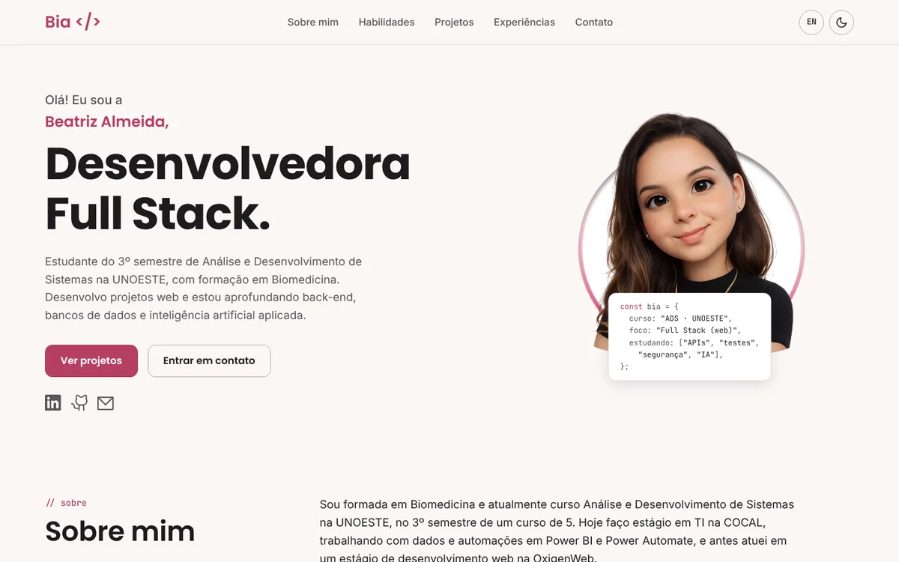

# Bia </> — Portfólio Pessoal

Portfólio pessoal desenvolvido com HTML, CSS e JavaScript.
O objetivo foi criar uma interface moderna, responsiva e organizada, colocando em prática conhecimentos de desenvolvimento front-end adquiridos durante meus estudos e cursos.

## 🔗 Acesse

[Página do Portfólio](https://beatrizalmc.github.io/meu-portfolio/)

---

## Preview



---

## Protótipo no Figma

Antes do desenvolvimento, todo o layout foi planejado e prototipado no Figma, incluindo:

- estrutura visual;
- paleta de cores;
- organização das seções;
- responsividade;
- identidade visual do projeto.

O protótipo serviu como referência principal durante a implementação do site.

---

## Seções

- **Apresentação** — nome, área de atuação, botões de ação e links para LinkedIn, GitHub e e-mail
- **Sobre mim** — trajetória, interesses e foco de estudo
- **Habilidades** — tecnologias organizadas por área, com o nível de cada uma (Avançado, Intermediário, Básico ou Estudando)
- **Projetos** — cards com imagem, tecnologias, funcionalidades e links, com filtro por categoria
- **Experiência e formação** — linha do tempo, formação acadêmica, iniciação científica e cursos
- **Contato** — e-mail, LinkedIn e GitHub

---

## Funcionalidades

- **Modo claro/escuro** — alternância de tema via botão no header, salvo no navegador e com a preferência do sistema como padrão
- **Mudar PT para EN** — versão em português (`index.html`) e em inglês (`en/index.html`)
- **Menu responsivo** — navbar colapsável em dispositivos móveis, fechando com `Esc`
- **Conteúdo a partir de um arquivo de dados** — projetos, habilidades, experiências, formação e cursos ficam em `js/dados.js`
- **Duração das experiências automática** — o tempo de cada experiência é calculado a partir das datas
- **Filtros de projetos** por categoria (aparecem quando há mais de uma categoria)
- **Animações discretas** ao carregar e ao rolar, desligadas para quem prefere menos movimento
- **Botão "Voltar ao topo"** fixo, exibido após scroll
- **Acessibilidade** — link "Pular para o conteúdo", foco visível, navegação por teclado e textos alternativos
- **SEO** — metadados, Open Graph, `hreflang`, `sitemap.xml` e `robots.txt`
- **Layout responsivo** com breakpoints para todas as telas (< 576px até ≥ 1400px)

---

## Tecnologias

- HTML5
- CSS3 (Flexbox, Grid, CSS Custom Properties, media queries)
- JavaScript (ES6+)
- Git e GitHub
- Figma
- [Bootstrap 5.3](https://getbootstrap.com/) (apenas o CSS, para a grade)
- [Google Fonts](https://fonts.google.com/) — Poppins, Inter e JetBrains Mono
- [Devicon](https://devicon.dev/) — logos das tecnologias (licença MIT, em `images/tech/LICENSE-devicon.txt`)

---

## 📁 Estrutura

```
meu-portfolio/
├── index.html            (versão em português)
├── en/
│   └── index.html        (versão em inglês)
├── css/
│   └── style.css
├── js/
│   ├── dados.js          (projetos, habilidades, experiências, formação e cursos)
│   └── script.js         (tema, menu, filtros e criação dos cards)
├── assets/               (coloque aqui o currículo: curriculo.pdf)
├── images/
│   ├── icons/favicon.png
│   ├── tech/             (logos das tecnologias)
│   ├── foto-principal.png
│   ├── og-preview.png    (prévia ao compartilhar o link)
│   └── proj-*.webp       (imagens dos projetos)
├── robots.txt
├── sitemap.xml
└── README.md
```

---

## ✏️ Como atualizar o conteúdo

Quase tudo se atualiza em **`js/dados.js`**, sem mexer no HTML. Os textos têm versão em português (`pt`) e inglês (`en`).

- **Novo projeto** — copie um bloco da lista `projetos`, cole no fim e preencha. O que ficar vazio não aparece no card.
  Salve a imagem em `images/` (de preferência `.webp`).
- **Nova tecnologia** — adicione uma linha em um grupo da lista `habilidades`, com o nível: `avancado`, `intermediario`, `basico-intermediario`, `basico` ou `estudando`.
- **Nova experiência** — adicione um bloco na lista `experiencias`, com `inicio` e `fim` no formato `"AAAA-MM"`.
  Deixe `fim: ""` para a experiência atual: o tempo é recalculado sozinho a cada visita.
- **Cursos e certificações** — preencha a lista `cursos` (há um modelo comentado). O bloco só aparece na página quando há itens.
- **Currículo** — salve o PDF em `assets/curriculo.pdf` e remova o atributo `hidden` do botão "Currículo" no `index.html` e no `en/index.html`.

---

## 🚀 Como rodar localmente

```bash
# Clone o repositório
git clone https://github.com/beatrizalmc/meu-portfolio.git

# Abra o arquivo no navegador
open index.html
# ou arraste o arquivo para o navegador
```

Não há dependências de build — o projeto roda diretamente no navegador.
Para publicar, basta enviar para o GitHub com o GitHub Pages ativado na branch principal.

---

## 👩‍💻 Autora

Feito por **Beatriz Almeida** — estudante de Análise e Desenvolvimento de Sistemas pela UNOESTE.

[](https://www.linkedin.com/in/beatrizalmc)
[](https://github.com/beatrizalmc)
